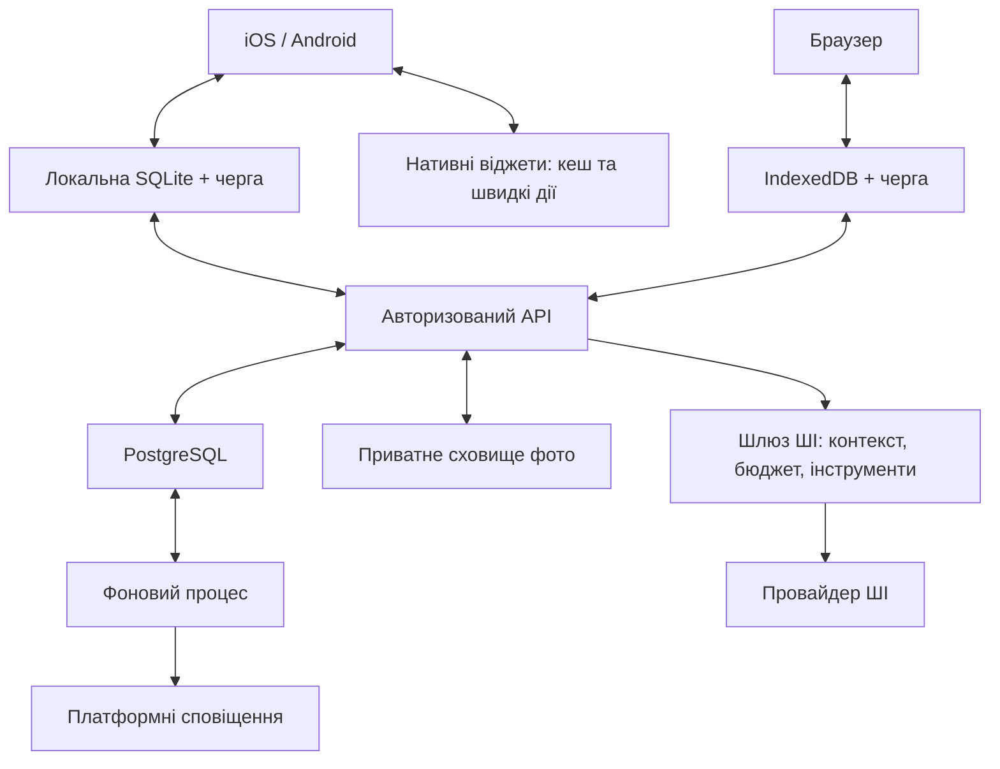

# EMBER v1 — архітектура

Основа: [концепція](../specs/ember-concept-v1.md), [план](../plans/ember-v1-todo.md), [аудит healthBot](../audits/healthbot-2026-11-02.md). Рішення V1-002 погоджене користувачем 02.11.2026 після пояснення вибору БД. Погоджено архітектурний напрямок, включно з PostgreSQL; це не дозвіл на реалізацію, міграцію чи витрати. Усі погоджені модулі v1, три платформи та віджети залишаються в обсязі.

## 1. Рекомендований склад

| Частина | Пропозиція | Призначення |
| --- | --- | --- |
| iOS та Android | React Native + Expo, власні development builds | Спільні мобільні екрани з доступом до нативних компонентів |
| Браузер | React + TypeScript + Vite, адаптивний вебклієнт | Повноцінна композиція для Mac і телефонного браузера |
| Спільні пакети | TypeScript: правила, розрахунки, контракти, переклади, дизайн-токени | Одна логіка КБЖВ, порцій, станів запису й синхронізації |
| Сервер | Node.js + TypeScript, модульний Express API | Авторизація, підтверджені записи, ШІ, синхронізація |
| Фонові задачі | Окремий процес того самого серверного проєкту | Підсумки, нагадування, імпорт довідника, очищення фото |
| Основна БД | PostgreSQL — погоджено | Особисті записи, довідники, версії, черги, облік витрат |
| Локальні дані | SQLite на мобільних; IndexedDB у браузері | Робота без мережі, останні продукти, чернетки й черга змін |
| Файли | Приватне об’єктне сховище | Фото тіла та тимчасові зображення за погодженими правилами |
| Віджети | iOS: SwiftUI / WidgetKit / App Intents; Android: Kotlin / Glance | Окремі платформні інтерфейси зі спільними контрактами даних |

Це один продукт в одному репозиторії. API та фоновий процес використовують спільні модулі. Мікросервіси, окрема векторна БД та постійно запущена мережа агентів для v1 не потрібні. Провайдери хостингу, авторизації та сховища ще не вибрані.

Expo development builds дозволяють додавати нативні бібліотеки; Expo Go не є достатньою перевіркою наших віджетів і платформних можливостей. [Документація Expo](https://docs.expo.dev/develop/development-builds/introduction/).

Компроміс: окремий вебінтерфейс означає додаткову роботу над екранами. Пропоную це заради вже схваленого вигляду на Mac, свободи фонових анімацій і мобільної зручності. Універсальний інтерфейс через React Native Web є альтернативою, але економію треба перевіряти на наших екранах; не обіцяємо 100% спільного UI.

## 2. Основний рух даних

Звичайне внесення відразу зберігається локально й показується як «очікує синхронізації». Сервер перевіряє власника, версію, правила та ідентифікатор операції перед прийняттям. Підтверджена сервером версія є спільною для пристроїв. Втрата мережі не повинна блокувати ручний запис.

ШІ повертає пропозицію або чернетку. Зміни фактів, планів і рекомендацій, для яких концепція вимагає підтвердження, застосовуються лише після нього. Не можна напряму переносити з healthBot автоматичний запис їжі з tool call.

## 3. База продуктів і база особистих даних

Це два логічні розділи однієї серверної БД; два окремих сервери БД не потрібні.

- **Харчовий довідник:** продукт, бренд, ресторан/місто, джерело, ліцензія, зовнішній ID, дата оновлення, поживність на 100 г, версія. Особисті продукти мають власника й не стають загальними автоматично.
- **Особисті записи:** профіль, цілі, прийоми їжі, рецепти й приготовані партії, тренування та підходи, сон і пробудження, виміри, звички, стан, налаштування, пам’ять ШІ.
- **Службові записи:** сесії пристроїв, операції синхронізації, версії, видалення, пропозиції ШІ, використання бюджету, правила й окремі спрацювання нагадувань.

Кожний прийом їжі зберігає знімок поживності, кількість, одиницю, джерело й точність на момент підтвердження. Оновлення каталогу не змінює минулі підсумки. Невідомий білок або вага — порожнє значення з ознакою неповноти, а не нуль.

Рецепт і конкретне приготування — окремі сутності. Заміна інгредієнта сьогодні створює нову версію/партію. Сира маса, готовий вихід і з’їдена порція не змішуються. У запису є час події, час внесення та часовий пояс; історична дата споживання не змінюється непомітно через подорож.

На телефон не завантажується весь світовий каталог. Кешуються особисті та недавні продукти, рецепти й потрібна історія; повний пошук працює через сервер. Джерела для українських продуктів і ресторанів, дозволений обсяг кешування й імпорт — окрема задача V1-005. Базу ще не завантажено.

## 4. MongoDB чи PostgreSQL

| Критерій | Зберегти MongoDB | Вибрати PostgreSQL |
| --- | --- | --- |
| Наявна робота | Залишаються Mongoose та частина моделей | Потрібний новий шар зберігання |
| Пов’язані сутності | Зв’язки та правила видалення значною мірою контролює код | Зовнішні ключі й обмеження допомагають захистити зв’язки |
| Атомарні операції | Підтримуються багатодокументні транзакції; потрібна відповідна конфігурація | Транзакції та обмеження добре відповідають підтвердженню пакета записів |
| Гнучкий контекст ШІ | Природний документний формат | JSONB для гнучких полів поряд зі структурованими таблицями |
| Вартість переходу | Менша зміна технології; модель все одно треба суттєво доробити | Додаткова робота зараз; зручна основа для історії, звітів і майбутнього планера |

**Рекомендація: PostgreSQL для EMBER.** Це інженерний висновок з наших вимог, а не твердження, що MongoDB ненадійна. PostgreSQL має механізми унікальності та зовнішніх ключів; MongoDB також підтримує ACID-транзакції. [PostgreSQL: обмеження](https://www.postgresql.org/docs/current/ddl-constraints.html), [MongoDB: транзакції](https://www.mongodb.com/docs/manual/core/transactions/).

Перехід від MongoDB у healthBot до PostgreSQL для EMBER явно погоджений користувачем 02.11.2026. Реалізація та міграція ще не розпочаті. Якщо вже є потрібні реальні записи, спочатку окремо визначаємо їх обсяг, робимо резервну копію, пробний перенос і звіряємо кількості та підсумки. Наявність таких даних аудит коду не встановлював. Стару БД не видаляємо автоматично.

## 5. Офлайн, повтори й конфлікти

- Кожна дія отримує стабільний operation ID. Повтор надсилання повертає попередній результат, а не створює другий прийом їжі.
- Збереження локального запису та локальної черги відбувається разом. Перезапуск не втрачає незавершену синхронізацію.
- Для редагування передається базова версія запису. Якщо інший пристрій її змінив, показуємо конфлікт; не перетираємо грамовку мовчки.
- Відкладений запис після видалення не воскресає. Позначки видалення й термін їх утримання потрібно визначити у V1-009; дуже старий клієнт має пройти повну синхронізацію.
- Плани, факти й чернетки мають різні стани. Запланований обід не збільшує фактично спожиті калорії.
- Офлайн доступні локально збережені продукти й ручні записи. Фотоаналіз та інші запити ШІ чекають мережі; автоматичне платне відправлення після відновлення мережі потребує визначеного правила.

Локальна БД сама по собі не забезпечує синхронізацію: протокол, конфлікти й відновлення — окрема реалізація. [Expo: local-first](https://docs.expo.dev/guides/local-first/).

## 6. ШІ та бюджет

ШІ підключається через сервер. Ключі провайдера не потрапляють до клієнтів. Розрахунки КБЖВ, повтор страви, збереження підходів і звичок працюють без моделі.

Перший кандидат — одна модель з обмеженим набором інструментів і тематичним контекстом. Другий — маршрутизатор та спеціалісти. Вибір у V1-006 після порівняння на однакових повідомленнях: змішаний запис їжі й самопочуття, рецепт зі змінами, тренування, вечірній пакет. Враховуємо сумарну ціну, затримку й виправлення. Архітектура дозволяє обидва варіанти без зміни даних користувача.

Перед викликом сервер атомарно резервує оцінку витрат, обмежує довжину відповіді й кількість інструментальних кроків. Після відповіді звіряє фактичне використання. Паралельні фото й текст не можуть окремо використати весь залишок. Після тайм-ауту невизначене списання не оголошується нульовим; резерв не звільняється без правила звірки.

5 USD/місяць — ціль бюджету ШІ, а не підтверджена достатність або тариф. Дата скидання, поріг попередження, моделі, правила повторів і провайдерський ліміт залишаються у V1-007. Після вичерпання ручні функції продовжують працювати. Сервер, сховище, доставка email і встановлення мобільних збірок мають окрему оцінку витрат.

Пам’ять вподобань зберігається структуровано, з джерелом і можливістю змінити/видалити. Видалені вподобання не повинні знову повертатися через старий чат. До моделі передається лише потрібний контекст; повна історія щоразу не потрібна.

## 7. Віджети, нагадування й сон

П’ять погоджених типів віджетів лишаються у v1. Віджет читає компактний кеш з часом оновлення, виконує підтримувану платформою дію або відкриває конкретний екран. Запис звички через віджет проходить той самий захист від повторів. Повноцінний діалог ШІ залишається в застосунку.

Платформні компоненти: [Apple: розширення SwiftUI та WidgetKit](https://developer.apple.com/documentation/swiftui/app-extensions), [Android: Glance](https://developer.android.com/develop/ui/compose/glance). Перелік доступних розмірів, дій, режимів екрана блокування й оновлень перевіряється на цільових ОС у V1-004. Не обіцяємо однакові можливості або миттєве фонове оновлення всюди.

Нагадування мають правило та окремі спрацювання. Сервер перед відправкою перевіряє згоду, виконання, тихі години, контекст і попередню доставку. Черга задач зберігається в БД. Факт спроби, прийняття push-провайдером і прочитання користувачем — різні речі; гарантії «рівно один раз» для доставки немає. Офлайн-виконання на іншому пристрої може бути невідомим серверу — цей крайовий випадок потрібно опрацювати, а не обіцяти абсолютне скасування.

Сон має ручний/підтверджений базовий сценарій. Визначення останнього та першого використання всього телефона, виключення будильника й нічних пробуджень не вважаємо доступним до окремої перевірки V1-003. Браузерний час активності не видаємо за активність усього телефона. Майбутні гаджети підключаються через адаптери джерел із захистом від подвійного обліку.

## 8. Доступ, фото та видалення

Стабільний внутрішній user ID відділений від Apple/Google/email. Зв’язування способів входу вимагає підтвердження володіння обліковими записами. Кожен особистий запит перевіряє власника на сервері, навіть коли реальний користувач один. Адмінські маршрути healthBot не використовуються як особистий API.

На мобільному секрети сесії мають зберігатись у системному захищеному сховищі; у вебі пропонується захищена серверна cookie-сесія з CSRF-захистом. Біометричне розблокування не замінює авторизацію сервера. Окремо визначаємо захист локальної БД, резервних копій та поведінку віджетів на заблокованому екрані.

Фото завантажуються до приватного сховища з обмеженим доступом. Для їжі/етикеток: розпізнати → підтвердити структуровані дані → видалити копію застосунку. Фото тіла мають іншу політику. Строки для покинутих чернеток, фото тренувальних програм, резервних копій і даних у провайдера ще не визначені — V1-010. Не обіцяємо негайного стирання у стороннього провайдера без перевірки.

Видалення облікового запису відкликає сесії, припиняє задачі, очищає особисті записи й файли та передає команду очищення іншим клієнтам при наступному зв’язку. Недоступний офлайн-пристрій неможливо дистанційно очистити негайно. Відновлення резервної копії не повинно повертати видалені облікові записи. Логи не містять повних чатів, фото, токенів або секретів.

## 9. Що використаємо з healthBot

Сценарії пошуку, чернетки довідників, частину серверного каркаса й адміністративного UI можна адаптувати після перевірки. Реєстрація через Telegram, volatile-пам’ять, автоматичне підтвердження ШІ, поточна історія КБЖВ та cron не переносяться як готові модулі. Палітри й візуальні рішення прототипу — основа дизайн-токенів; DOM-анімації не вважаються автоматично сумісними з нативними екранами.

Майбутній планер матиме власний модуль. Спільний планер двох людей — окреме продуктове рішення з явним доступом до конкретних подій, без автоматичного відкриття здоров’я, фото й чатів партнера.

## 10. Порядок після погодження

1. Закрити технічні перевірки етапу 0: сон, віджети, база продуктів, бюджет ШІ, приватне встановлення й витрати. Якщо обмеження змінює погоджений продукт — спочатку обговорити альтернативу.
2. Спроєктувати детальні схеми, API і синхронізацію на сценарії «їжа → грами → підтвердження → збереження → другий пристрій».
3. За окремим дорученням на розробку створити сервер, спільні пакети й мінімальні клієнти одночасно. Спершу перевірити шлях на iPhone, Android і вебі; не відкладати першу мобільну збірку до завершення всього браузера.
4. Додавати модулі у порядку чинного roadmap. ШІ — етап 4 після харчової основи, а перевірка його бюджету й контрактів — вже на етапі 0.

### Перевірки приймання архітектурної основи

- Повторене надсилання одного прийому їжі створює один запис.
- Офлайн-запис переживає закриття застосунку й синхронізується після повернення мережі.
- Два пристрої не перезаписують різні зміни грамів без повідомлення про конфлікт.
- Оновлення продукту/рецепта не змінює вже підтверджені минулі КБЖВ.
- Чернетка й план не потрапляють до спожитого; пакет підтверджується цілісно.
- Чужий ID запису не дає доступу до нього; віджет також дотримується налаштувань приватності.
- Паралельні запити ШІ враховують спільні резерви; повтор відповіді не дублює факти.
- Пропущена/виконана звичка скасовує відповідне актуальне спрацювання, не всю серію.
- Видалення та відновлення з резервної копії не повертають видалені дані.
- На трьох платформах однаковий приклад дає однакові КБЖВ; основні записи доступні без ШІ.

### Рішення, що залишаються відкритими

Потреба переносу реальних даних healthBot; провайдери й витрати; мінімальні ОС/браузери та розповсюдження приватного пілота; усі окремо позначені перевірки V1-003–V1-012. Архітектурна пропозиція не закриває їх автоматично.
